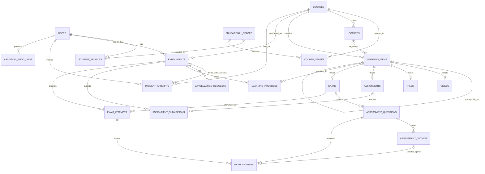

# LMS — Phase 4: Domain & Database Design
## Revised ERD Proposal (MVP)

> **Status:** Consolidated database design aligned with the current migration baseline. The migration SQL is the executable source of truth for the current schema; this document explains the model and its rules.
>
> **Goal:** Keep the MVP practical while protecting business rules, data integrity, payment consistency, and student history.

---

## 1. Design decisions

- The platform currently has one `ADMIN`, multiple `ASSISTANT` users, and `STUDENT` users.
- `users` stores shared authentication/account data.
- `student_profiles` stores student-only data, including `date_of_birth` because registration requires it.
- Student statuses: `PENDING`, `APPROVED`, `REJECTED`, `BANNED`.
- Assistant status is separate: `ACTIVE`, `DEACTIVATED`.
- Courses can be associated with multiple educational stages; a stage can have multiple courses.
- A course contains lectures. A learning item can belong to a lecture or directly to a course.
- Video, File, Assignment, and Exam share common Learning Item behavior: required/optional, ordering, and prerequisite. Learning Items are not archived.
- Learning Item configuration is immutable immediately after creation.
- Video and File Learning Items may be hard-deleted after prerequisite dependents are removed; their progress rows are deleted.
- Assignment and Exam Learning Items cannot be edited or deleted. No Assignment or Exam versioning exists.
- An enrollment is created only after a payment is verified as successful. Failed/pending payments must not require an enrollment.
- Progress belongs to a specific enrollment, so a student who purchases a course again gets fresh progress while historical enrollment/progress remains.
- Assistant audit logs are append-only.
- No certificate, notification, wallet, or multi-tenant tables in this MVP proposal.

---

## 2. ERD overview

**Important:** The Mermaid diagram shows the main logical relationships. Some cross-table business rules (for example, ensuring a learning item and an enrollment belong to the same course) need additional database constraints, transaction logic, or both; a basic foreign key alone may not enforce them.

---

## 3. Tables and key columns

`PK` = Primary Key, `FK` = Foreign Key, `UQ` = Unique.

### Identity domain

#### `users`
- `id` — PK
- `full_name`
- `email` — UQ
- `phone` — UQ
- `password_hash`
- `role` — `ADMIN` / `ASSISTANT` / `STUDENT`
- `assistant_status` — nullable or only applicable to assistants; `ACTIVE` / `DEACTIVATED`
- `created_at`

**Decision:** Do not include `deleted_at` in the MVP unless a real account-deletion use case is introduced. Student banning and assistant deactivation are represented by their respective statuses, not soft deletion.

#### `student_profiles`
- `user_id` — PK, FK → `users.id`
- `national_id` — UQ
- `date_of_birth`
- `address`
- `parent_phone` — not unique (siblings may share a guardian phone)
- `educational_stage_id` — FK → `educational_stages.id`
- `id_card_image`
- `status` — `PENDING` / `APPROVED` / `REJECTED` / `BANNED`

`student_profiles.user_id` being both PK and FK ensures at most one profile per user and that each profile points to an existing user. A separate rule must ensure the referenced user's role is `STUDENT`.

#### `educational_stages`
- `id` — PK
- `name` — UQ
- `archived_at` — nullable

#### `assistant_audit_logs`
- `id` — PK
- `assistant_id` — FK → `users.id`
- `action`
- `entity_type`
- `entity_id` — identifier of the affected record; polymorphic, so it is not a normal FK
- `reason` — nullable unless the action requires a reason
- `created_at`

Audit entries are append-only. The application must verify that `assistant_id` belongs to an Assistant; a basic FK only proves that the user exists. Record required audit entries atomically with the business action where both are stored in PostgreSQL.

### Course and content domain

#### `courses`
- `id` — PK
- `title`
- `description` — nullable
- `price`
- `status` — `DRAFT` / `PUBLISHED`

Courses have no archive/restore/delete workflow. `PUBLISHED -> DRAFT` stops discovery/new purchases while existing ACTIVE Enrollments retain access. Course rows are retained.

#### `course_stages`
- `course_id` — PK part, FK → `courses.id`
- `stage_id` — PK part, FK → `educational_stages.id`

Composite PK: (`course_id`, `stage_id`). This prevents duplicate mappings.

#### `lectures`
- `id` — PK
- `course_id` — FK → `courses.id`
- `title`
- `position`

Do **not** make `title` globally unique. Different courses can have lectures with the same title. If needed, uniqueness should be scoped to a course (for example, course + position).

#### `learning_items`
- `id` — PK
- `course_id` — FK → `courses.id`
- `lecture_id` — nullable FK → `lectures.id`
- `type` — `VIDEO` / `FILE` / `ASSIGNMENT` / `EXAM`
- `title`
- `description` — nullable, if included in the shared item definition
- `position`
- `is_required`
- `prerequisite_id` — nullable self-FK → `learning_items.id`
- `created_at`

All common fields are immutable after creation. There is no `archived_at` and no Learning Item restore workflow.

Rules to enforce:
- If `lecture_id` is present, that lecture must belong to the same `course_id`.
- A prerequisite must be a different learning item in the same course.
- No prerequisite cycles.
- A required item cannot depend on an optional item.
- A Video/File item cannot be hard-deleted while another item references it as a prerequisite. Remove that relationship explicitly before deletion.
- Assignment and Exam items cannot be deleted.
- Use restrictive foreign keys for prerequisite references and Learning Item detail/progress references. The deletion service explicitly removes progress rows and the Video/File detail row, then deletes the Learning Item row in one PostgreSQL transaction. Do not use cascading deletion that could accidentally remove Assignment/Exam records or dependent items.
- The type must match exactly one corresponding detail record (video, file, assignment, or exam); a basic FK does not enforce this by itself.
- Prevent updates to Learning Item definitions and type-specific records after creation through service rules and, where appropriate, database permissions/triggers.

#### `videos`
- `learning_item_id` — PK, FK → `learning_items.id`
- `duration`
- `video_storage_key` — private-storage identifier

Keep video files private; do not treat a public URL as authorization.

#### `files`
- `learning_item_id` — PK, FK → `learning_items.id`
- `storage_key` — private-storage identifier
- `original_filename`
- `mime_type`
- `size_bytes`

The File detail record is immutable. Before deleting its detail/item rows, the same database transaction inserts a `storage_cleanup_outbox` record containing the storage provider/key. A cleanup processor deletes the physical object after commit and marks the outbox record complete; failures remain retryable. The DB transaction cannot atomically roll back an external object-storage operation.

#### `storage_cleanup_outbox`
- `id` — PK
- `storage_provider`
- `storage_key`
- `status` — `PENDING` / `PROCESSING` / `COMPLETED` / `FAILED`
- `attempt_count`
- `created_at`
- `processed_at` — nullable
- `last_error` — nullable, operational detail for retry diagnosis

Insert the cleanup task in the same transaction that deletes the Video/File Learning Item and its database records. The processor retries failed object deletions. This is a lightweight reliability mechanism, not a requirement to introduce a third-party queue service.

#### `assignments`
- `learning_item_id` — PK, FK → `learning_items.id`
- `instructions` or `description`
- `due_at` — nullable if assignments without deadlines are allowed
- `allowed_file_types` — as required by the upload rules
- `max_submission_size` — as required by the upload rules

Assignment definition is immutable immediately after creation. No `assignment_versions` table exists.

#### `exams`
- `learning_item_id` — PK, FK → `learning_items.id`
- `duration`
- `total_marks`
- Other fixed settings needed by the MVP

#### `assessment_questions`
- `id` — PK
- `learning_item_id` — FK → `learning_items.id`
- `type` — `MULTIPLE_CHOICE` / `TRUE_FALSE` / `ESSAY`
- `question_text`
- `points`
- `position`

#### `assessment_options`
- `id` — PK
- `question_id` — FK → `assessment_questions.id`
- `option_text`
- `is_correct`
- `position`

**Exam immutability:** The exam, its questions, options, correct answers, marks, passing score, time limit, and metadata cannot be edited or deleted after creation. Create the exam and its dependent records in one transaction. If there is a mistake, create a new exam. No `exam_versions` table.

### Enrollment and payment domain

#### `payment_attempts`
- `id` — PK
- `student_id` — FK → `users.id`
- `course_id` — FK → `courses.id`
- `enrollment_id` — nullable FK → `enrollments.id`, linked after a successful payment has been reconciled
- `amount` — snapshot of the amount for this payment attempt
- `payment_method` or provider
- `provider_reference` — provider transaction/event identifier; unique where applicable
- `status` — `PENDING` / `SUCCEEDED` / `FAILED`
- `created_at`

**Important relationship decision:** A payment attempt must not require an enrollment to exist first. Pending/failed attempts may have no enrollment. Once payment is verified, the backend must idempotently create or recover the enrollment and associate it with the successful attempt. The `enrollment_id` link is nullable for this reason.

Business rules:
- One pending payment attempt per student/course at a time.
- A pending attempt snapshots the course price.
- Verify provider confirmation; do not trust a client-side success redirect.
- Handle duplicate webhooks idempotently.
- Recover if payment succeeded but enrollment creation initially failed.
- A Payment Attempt may only be created while the Course is PUBLISHED. If the Course later becomes DRAFT, a verified successful payment for that valid attempt still creates/reconciles an ACTIVE Enrollment.

#### `enrollments`
- `id` — PK
- `student_id` — FK → `users.id`
- `course_id` — FK → `courses.id`
- `enrolled_at`
- `status` — `ACTIVE` / `CANCELLED` / `COMPLETED` (adjust if the final lifecycle needs a separate state)

Allow historical cancelled enrollments and repurchase. Enforce at most one active enrollment per student/course. Do not use a plain unique constraint on (`student_id`, `course_id`) because it would block repurchase after cancellation.

#### `cancellation_requests`
- `id` — PK
- `enrollment_id` — FK → `enrollments.id`
- `reason`
- `status` — `PENDING` / `APPROVED` / `REJECTED`
- `created_at`

Approving a request is not the same as cancelling an enrollment. For student-requested cancellation, the enrollment remains active until the required refund is completed; access is revoked when cancellation is finalized. Keep refund processing separate from the request decision.

### Learning and assessment domain

#### `learning_progress`
- `id` — PK
- `enrollment_id` — FK → `enrollments.id`
- `learning_item_id` — FK → `learning_items.id`
- `status` — `NOT_STARTED` / `IN_PROGRESS` / `COMPLETED`
- `completed_at` — nullable
- `score` — nullable, if needed for the item

Unique pair: (`enrollment_id`, `learning_item_id`). For Video/File hard deletion, the deletion transaction explicitly deletes matching progress rows before deleting the item. Progress for Assignment/Exam is retained because those items cannot be deleted.

The system must also ensure that the learning item belongs to the course of the enrollment. Progress is tracked per enrollment, not just per student/course, so repurchase starts fresh progress.

Progress rule: completed Required items / total Required items. If there are zero Required items, course completion is undefined. Videos require at least 80% watched; assignments complete when accepted; exams complete when the final grade is at least 50%. Essay grading pending must not mark an exam complete.

#### `assignment_submissions`
- `id` — PK
- `assignment_id` — FK → `assignments.learning_item_id`
- `enrollment_id` — FK → `enrollments.id`
- `content` or submission-storage key
- `submitted_at`
- `status` — `SUBMITTED` / `UNDER_REVIEW` / `ACCEPTED` / `REJECTED`
- `rejection_reason` — required when status is `REJECTED`
- `is_late` — may be derived from `submitted_at` and the immutable `due_at`, or stored if a snapshot is needed

Unique pair: (`assignment_id`, `enrollment_id`) — exactly one current submission per assignment/enrollment. Resubmission updates this row while `UNDER_REVIEW` or `REJECTED`; `ACCEPTED` is final. No submission history or grade is stored.

#### `exam_attempts`
- `id` — PK
- `enrollment_id` — FK → `enrollments.id`
- `exam_id` — FK → `exams.learning_item_id`
- `attempt_number`
- `started_at`
- `submitted_at` — nullable
- `score` — nullable until final grading
- `status` — `IN_PROGRESS` / `SUBMITTED` / `PENDING_GRADING` / `GRADED` / `INVALIDATED`
- `reset_idempotency_key` — unique key for a reset-created attempt, used to prevent duplicate reset requests from creating multiple opportunities

One attempt by default. An authorized reset creates a new attempt and preserves/invalidates the old attempt; reset reason/action should be audited and duplicate reset requests must be idempotent. Question and option order is randomized but not persisted per attempt; the database does not guarantee the same display order after reconnect. Enforce unique (`enrollment_id`, `exam_id`, `attempt_number`).

#### `exam_answers`
- `id` — PK
- `attempt_id` — FK → `exam_attempts.id`
- `question_id` — FK → `assessment_questions.id`
- `selected_option_id` — nullable FK → `assessment_options.id`
- `answer_text` — nullable
- `is_correct` — nullable
- `score` — nullable

The schema must prevent duplicate answers for the same (`attempt_id`, `question_id`) and ensure a selected option belongs to the question being answered. Create one answer row for every question when an attempt starts; selected option/answer text initially remain NULL for unanswered questions.

**Randomization persistence:** Questions and options are randomized by application behavior, but their per-attempt display order is not stored. There are no `exam_attempt_questions` or `exam_attempt_options` tables.

**Essay grading:** `exam_answers` stores the current grading result only. Regrading updates that result; there is no `exam_answer_grading_history` table.

---

## 4. Key relationships and integrity checks

1. `users` → `student_profiles`: one user has zero or one student profile; every profile belongs to one user.
2. A user with a student profile must have role `STUDENT`. A normal FK does not enforce this; use a deliberate database/application rule.
3. `courses` ↔ `educational_stages`: many-to-many via `course_stages`.
4. `courses` → `lectures` and `learning_items`: one-to-many.
5. `learning_items` → `videos` / `files` / `assignments` / `exams`: exactly one detail record matching the item's type.
6. `learning_progress` must be unique per enrollment/item pair, and both must belong to the same course.
7. `enrollments` must allow history but prevent more than one active enrollment per student/course.
8. Payment attempts exist independently of enrollments until payment success is verified and reconciled.
9. Learning Item definitions are immutable after creation. Video/File may be hard-deleted only after prerequisite dependents are removed; their progress/detail/item rows are deleted in one DB transaction. Assignment/Exam cannot be edited or deleted.
10. Assignment submissions are unique per assignment/enrollment and only the latest row is retained.
11. Exam question/option order is randomized but not persisted per attempt; Essay regrading updates the current result without a separate grading-history table.
12. Video/File deletion records an object-storage cleanup task transactionally before deleting the database metadata; cleanup is retryable.
13. Assistant audit records are append-only; required logs should be committed atomically with the operation.

---

## 5. Explicitly deferred from this MVP

Do not add these just to increase architecture complexity:

- Wallet or stored balance
- Certificates
- Notification system
- Multi-tenant / multiple independent Admin owners
- Assignment versioning
- Exam versioning
- Course archival/deletion
- Learning Item archival/restoration
- Course-specific assistant permission matrices (Assistants currently share operational permissions)
- Redis, queues, or WebSockets before a real use case requires them

---

---

## Latest Confirmed Decisions — 2026-11-17

This section supersedes any conflicting earlier wording in this document. It records decisions confirmed after the original phase review.

- **Project status:** Product definition, requirements, business rules, domain/database design, and architecture are complete enough to begin implementation. The project is now in **Implementation**. There is no separate API Design phase/gate. API contracts and endpoint details will be designed incrementally as each feature is implemented, after reviewing that feature's requirements and business rules.
- **Exam randomization:** Questions and options are randomized, but their per-attempt display order is **not persisted**. Do not create `exam_attempt_questions` or `exam_attempt_options` tables. The database does not promise that the same randomized order will be restored after reconnect.
- **Essay grading:** Keep only the current grading result. Regrading updates the current result; do not create `exam_answer_grading_history` or retain previous grading snapshots. The latest grader/time may be stored with the current answer if required by the implementation, but no grading-history timeline is maintained.
- **Exam answers:** Create one `exam_answers` row for every question when an attempt starts. Initially the answer fields may be NULL. This makes unanswered questions distinguishable from answered-but-wrong questions.
- **Exam pass rule:** Passing score is fixed at 50% of the exam's total marks. It is not a configurable per-exam field in the current schema.
- **Question schema:** The current table names are `assessment_questions` and `assessment_options`, not `exam_questions` and `exam_options`.
- **Assignment submissions:** Keep one current submission per (`assignment_id`, `enrollment_id`). Resubmission replaces/updates that row; no submission-version history. `is_late` is derived from `submitted_at` and the assignment's immutable `due_at`, not stored as an independent fact.
- **Cancellation request withdrawal:** A Student may withdraw only a `PENDING` request; withdrawal physically deletes that request. There is no `WITHDRAWN` status. The stored statuses are `PENDING`, `APPROVED`, and `REJECTED`.
- **Current database baseline:** The available migration set contains 22 migrations, ending with `022_create_exam_answers.sql`. The migrations are the source of truth for what is currently implemented in PostgreSQL; conceptual requirements in these documents remain the source of truth for intended behavior. Any gap between them must be tracked explicitly rather than assumed implemented.

